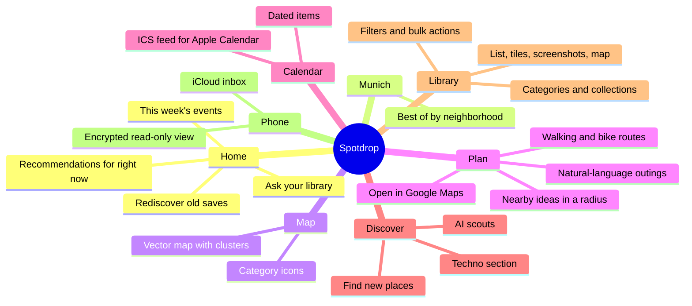
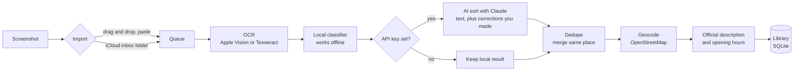
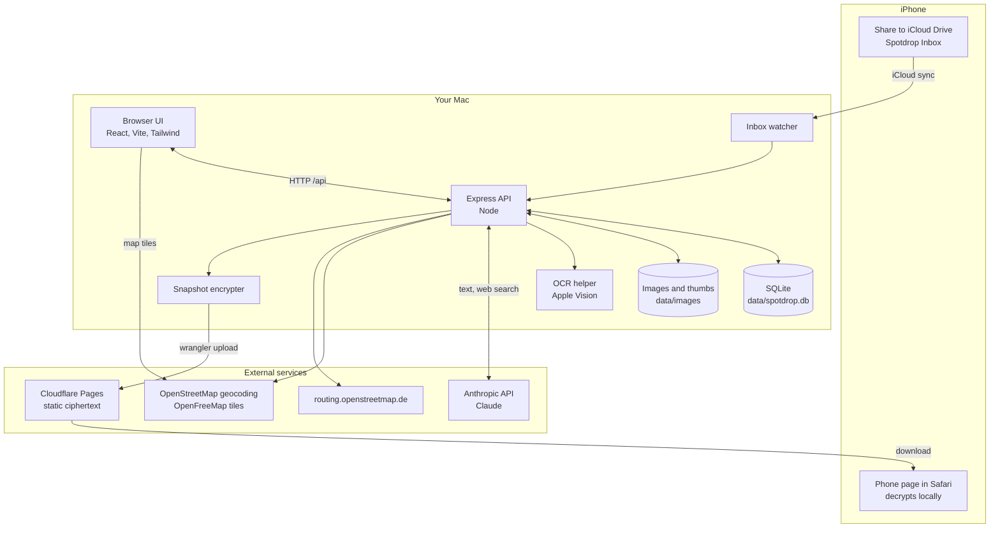
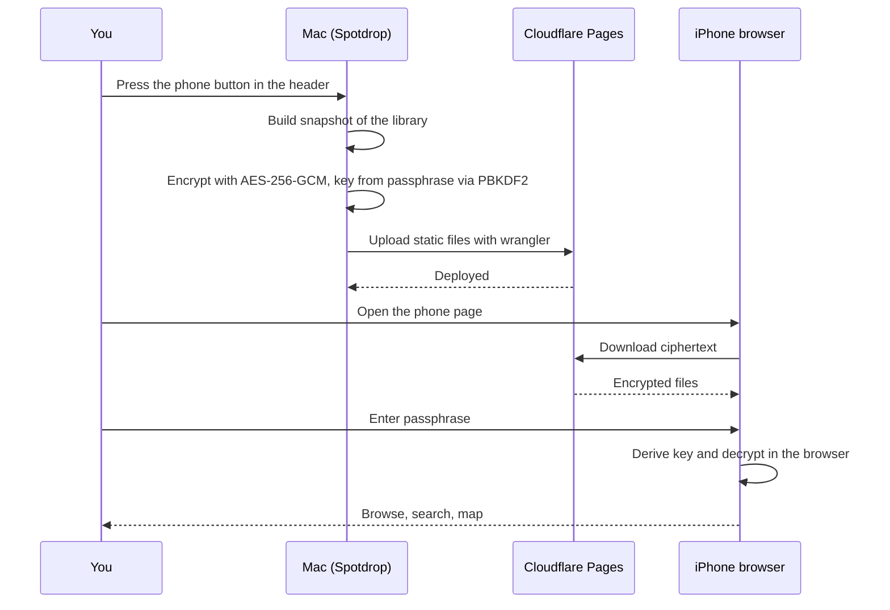
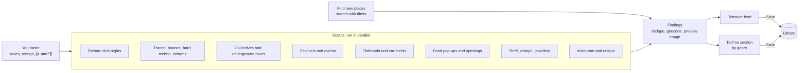

# 🍜 Spotdrop

Drag screenshots straight out of **Apple Photos** (from Instagram, TikTok, reels, X, Reddit, websites) and get an organized, searchable library instead of a camera roll where they rot. Food spots, bars, places, events, recipes, accounts to follow, tech concepts, products, ideas: each screenshot is read, sorted into a category, summarized and tagged. Everything is stored locally.

## What it does

- 📸 **Turns screenshots into a library.** Drop them in, get title, summary, tags, category and (for places) address, opening hours and a map pin.
- 🧠 **Sorts with AI, learns from you.** Claude sorts by the screenshot's text; your corrections are remembered. Without an API key a built-in local classifier still works.
- 🔎 **Finds things again.** Search, filters, collections, and an "Ask your library" box ("date night in Glockenbach").
- 🗺️ **Shows it on a map** and plans outings: type what you feel like and get stops with walking or bike routes.
- 📅 **Keeps dates.** Events land in a calendar you can subscribe to in Apple Calendar (.ics feed).
- 🔭 **Discovers new things.** AI scouts search the web for events, techno nights, pop-ups and places that match your taste.
- 📱 **Works with your iPhone.** Send screenshots in through an iCloud folder; read your library on the phone as an encrypted, read-only web page.
- 🔒 **Stays local.** Images, database and API key live in `./data` on your Mac.

### The main screen

```
┌───────────────┬────────────────────────────────────────────────────────┐
│ 🍜 Spotdrop   │  🔍 Search your library…      [+ Add]  📱 Sync   ⚙     │
│               ├────────────────────────────────────────────────────────┤
│ Home          │                                                        │
│ Munich        │   Content of the selected section                      │
│ Map           │                                                        │
│ Plan          │   ┌────────┐ ┌────────┐ ┌────────┐ ┌────────┐          │
│ Calendar      │   │ card   │ │ card   │ │ card   │ │ card   │          │
│ Discover      │   │ title  │ │ title  │ │ title  │ │ title  │          │
│               │   │ ★ tags │ │ ★ tags │ │ ★ tags │ │ ★ tags │          │
│ Library       │   └────────┘ └────────┘ └────────┘ └────────┘          │
│  Saved        │   list · tiles · screenshots · map views               │
│  Categories   │                                                        │
│  Collections  │   Click a card → detail panel on the right             │
│  Filters      │   Drop screenshots anywhere on the window              │
└───────────────┴────────────────────────────────────────────────────────┘
```

### Feature map



## How it works



```
screenshot ──► local OCR (Apple Vision on macOS · Tesseract in Docker)
           ──► Claude reads the *text* → category, title, summary, key points, tags
                                         (+ food: meal, drinks, sit-down/to-go, "how special" · accounts: handle, platform)
           ──► optional web research (Claude web search) → address, dishes, links, who an account is
           ──► geocoding (OpenStreetMap) → pin on the map
           ──► official description + opening hours lookup
           ──► duplicate check → "looks like Bar Basso you saved in May. Merge?"
```

### Architecture



### Phone sync

The phone view is read-only. Your data is encrypted on the Mac with AES-256-GCM (key derived from your passphrase with PBKDF2); Cloudflare only ever stores ciphertext. Sync is manual: press **📱** in the web app header.



### Discover

Click **Refresh** and AI scouts run in parallel, each with web search and page fetching. Finds are de-duplicated, geocoded and shown as a feed; the three techno scouts also fill their own section.



**Privacy**
- Images, database and API key stay in `./data` on your machine.
- Only the OCR text goes to Claude. The image is sent only when OCR finds almost no text (you can turn this off in Settings) or when you click **Analyze image**.
- Without an API key the app runs 100 % offline (apart from map tiles and geocoding). It reads the text and guesses a name, and you fill in the rest.

**Layout**
- **Home:** an "Ask your library" box ("date night in Glockenbach"), plus recommendations for right now (brunch on Sunday morning, bars at night), this week's events, must-gos you haven't tried, a "rediscover" shelf of forgotten saves, and recently added.
- **Munich** (your home city, set in Settings): best restaurants, cafés, bars, things to do and shops, grouped and ranked, by neighborhood.
- **Map:** smooth vector map (OpenStreetMap via OpenFreeMap, no API key), category icons with names, clusters.
- **Plan:** describe an outing in plain words; get stops with walking or bike routes, reorder or remove stops, add nearby ideas in a radius, hand off to Google Maps.
- **Calendar:** everything with a date (pop-ups, markets, concerts…). Subscribe in Apple Calendar.
- **Library:** all items or the original screenshots, with categories, collections and filters.

**Discover** (sidebar → 🔭 Discover): a separate feed of new things in Munich picked for your taste. Click **Refresh** and eight AI scouts search the web in parallel: three techno scouts (club nights; trance/bounce/hard techno/schranz; collectives and underground raves, using Resident Advisor, rausgegangen.de, the clubs), festivals and events, Flohmarkt and car meets, food pop-ups and hyped openings, thrift/vintage/jewellery, and Instagram "happening" accounts plus quirky finds. Instagram is only read via web search, never scraped directly. The techno section can be refreshed on its own and filtered by genre. **Find new places** searches for venues by category with filters. Your taste comes from your library (what you save, rate, bookmark and visit), your own words, and 👍/👎 on cards. **Save** puts a find into your library. A full refresh costs about $0.80 on Haiku and up to ~$6 on Opus (see [Costs](#costs)).

**Library**
- **Categories** (one per screenshot, assigned automatically): 🍽️ Food · 🍸 Bars & Drinks · 🗺️ Places & Activities · 🧑‍🍳 Recipes · 👤 Accounts & People · 💻 Tech & Learning · 🛍️ Shopping · 💡 Ideas & Quotes · 📦 Misc
- **Your own categories:** sidebar → ⚙ next to *Categories* → *New category*. Give it a description ("Workout routines and gym tips") and the AI starts sorting matching screenshots into it. Pick which fields it gets (General, Food spot, Place, Recipe, Account).
- **Collections** group things across categories (e.g. "Japan trip" holding restaurants, sights and a few accounts). Screenshots dropped while a collection is open are added to it.
- **Each item** gets a title, summary, key points, cleaned-up text (quotes, code, prompts, recipe steps), topic tags and a 1–5 rating. Searching covers all of it plus the raw text in the screenshot.
- **Bulk sorting:** ⌘-click or the circle on a card to select it (shift-click selects a range, ⌘A selects everything visible). Then use *Move to*, *Collection*, *Looks good*, *Re-analyze* or *Delete*. You can also drag cards onto a category or collection in the sidebar.
- **Duplicates:** identical files are skipped on import, and the same place saved twice is merged automatically.
- **AI organizer:** every 20 new screenshots (or on demand, via ✨ next to *Categories*), the AI reviews the whole library as text. It creates new categories when enough items share a theme, moves mis-sorted items and merges duplicate tags. Every change is logged.
- **Storage:** screenshots are kept as compact WebP copies (≤1080 px wide, ~60 KB each).
- **It learns from you:** every move, rename, type fix, "Redo" instruction or "Looks good" is remembered. Similar screenshots then get sorted your way, by the AI (similar past corrections are shown to it) and by the on-device sorter (words are linked to categories). The organizer turns patterns into house rules, which you can see, edit and add to under ✨.
- **What you set wins:** fields you edit by hand (name, category, notes, rating…) are never overwritten when the AI re-analyzes an item.

**Food & places details:** Spot / Food post / Activity · Breakfast, Brunch, Lunch, Dinner, Snack, Dessert, Late night · Sit down / To go / Delivery · Type of place (café, bar, street food…) · Drinks (specialty coffee, matcha, cocktails, natural wine, craft beer…) · Cuisine & dishes (free tags) · Price · **How special** (1 = nice to know … 5 = once in a lifetime).

One screenshot of a "Top 5 cafés in Lisbon" post becomes five spots. Food and place filters (meal, drinks, sit-down/to-go…) appear in the sidebar when you're in those categories.

## iPhone

- **Send screenshots to the Mac:** on the iPhone use Share → Save to Files → iCloud Drive → *Spotdrop Inbox*. The Mac watches that folder, imports new files and moves them to `Imported`.
- **Read on the phone:** an encrypted, read-only copy of your library (sub-filters, map, opening hours, price). Set a passphrase and a Cloudflare account in the 📱 dialog in the header; press the button to sync manually (see the diagram above). It is not refreshed automatically.

## Run on your Mac (recommended, best OCR)

Needs Node.js ≥ 22.18 (`brew install node`) and the Xcode command-line tools (for the one-time Apple Vision OCR helper build).

```bash
npm install
npm run app          # builds the UI, then serves everything on http://localhost:5280
```

Or double-click **`Spotdrop.command`** in Finder.

**Always on, no terminal:** `npm run service:install` makes your Mac run Spotdrop in the background. It starts at login and restarts if it stops, so http://localhost:5280 always works. In Safari, *File → Add to Dock* gives it its own Dock icon. After pulling new code, run `npm run service:restart`. To remove it, run `npm run service:uninstall` (your data stays).

Then open ⚙️ Settings and paste your Anthropic API key (or `export ANTHROPIC_API_KEY=…` before starting).

**Adding screenshots:** drag from Photos, Finder or the desktop onto the window, paste with ⌘V, or click *Add screenshots*. To add more screenshots to an existing spot, drop them onto its open detail panel. HEIC files work.

Development with hot reload: `npm run dev` (UI on http://localhost:5173).

## Run as a container

```bash
docker compose up -d --build     # http://localhost:5280, data in ./data-docker
```

- OCR inside the container uses Tesseract (eng/deu/fra/ita/spa/por). It's good enough because Claude cleans up the text.
- To reach it from other devices (NAS or home server), remove `127.0.0.1:` from the port mapping **and** set `SPOTDROP_PASSWORD` (it turns on HTTP basic auth).

## Data & backup

- `data/spotdrop.db`: SQLite database
- `data/images`, `data/thumbs`: your screenshots
- `data/settings.json`: settings and API key
- Settings → *Export all data (JSON)*

To back up, copy the `data` folder.

## Costs

Everything that is not AI is free: OCR (Apple Vision / Tesseract), the local classifier, maps (OpenFreeMap), routes (OpenStreetMap routing), geocoding, the iCloud inbox, and the phone version on Cloudflare Pages (free plan). **You only pay Anthropic for Claude calls**, and the app runs fine without an API key (local sorting only).

**See what you really spent:** Settings → *AI cost* lists every feature with its calls, web searches and dollar cost for the last 7 days, 30 days or year. It's measured from each request's token usage at Anthropic's list prices. Your Anthropic console bill is the final word.

### Prices used (USD, [Anthropic pricing](https://platform.claude.com/docs/en/about-claude/pricing), Oct 2026)

| | Input / 1M tokens | Output / 1M tokens |
|---|---|---|
| Claude Opus 5.5 (default) | $4 | $20 |
| Claude Sonnet 5.5 | $2 | $10 |
| Claude Haiku 5.5 | $0.10 | $0.50 |
| Web search | $10 per 1,000 searches ($0.01 each) | |
| Web fetch (reading a page) | no extra charge, only the tokens of the page | |

You pick the model in Settings. It's used for everything below, so Haiku is roughly 30–40× cheaper on tokens than Opus. Web searches cost the same on every model.

### What each step costs

| Step | When it runs | What it sends | Haiku 5.5 | Sonnet 5.5 | Opus 5.5 |
|---|---|---|---|---|---|
| **Sorting a screenshot** | Automatically, once per new screenshot (and when you press *Analyze again*) | ~6,600 input tokens (system prompt and categories ~5,600, screenshot ~1,000) + ~1–2k output | ~$0.002 | ~$0.03 | ~$0.06 |
| ↳ with research | Only if *research* is on: up to 5 web searches to fill in address, website etc. | + search results as input tokens | + ~$0.02–0.06 | + ~$0.05–0.15 | + ~$0.1–0.3 |
| **Official description & opening hours** | Automatically once per new place; for older places only when you press *Fetch* in Settings | up to 3 searches + 2 page reads. **Measured:** 29,600 input, 730 output, 2 searches | **$0.023** | ~$0.09 | ~$0.15 |
| **Discover: one scout** | Only when you press *Refresh* | up to 8 searches + 5 page reads, a few turns; the page text is sent again each turn | ~$0.10 | ~$0.40 | ~$0.80 |
| Discover *Refresh all* | button | 8 scouts | ~$0.80 | ~$3 | ~$6 |
| Discover *Refresh techno* | button | 3 scouts | ~$0.30 | ~$1.20 | ~$2.40 |
| **Find new places** | button | 1 scout | ~$0.10 | ~$0.40 | ~$0.80 |
| **Plan an outing** | button | your request + up to a few hundred candidate places as text, no web | ~$0.002–0.005 | ~$0.05–0.10 | ~$0.10–0.20 |
| **Ask your library** | when you ask | your question + a compact list of your library, no web | ~$0.002–0.005 | ~$0.05–0.10 | ~$0.10–0.20 |
| **AI organizer** | button | category stats and samples | ~$0.005 | ~$0.10 | ~$0.20 |

Except for the two measured rows (marked), these are estimates from the request sizes and limits in the code. The *AI cost* panel shows the real numbers as you use the app.

**Nothing runs on a timer.** The only automatic AI use is sorting new screenshots and looking up their official info (about $0.03 per new place on Haiku, ~$0.20 on Opus). Discover, Find places, Plan, Ask and the organizer only run when you click.

Claude is called with Anthropic's server-side fallback enabled, so a refused or failed request falls back to another model instead of failing.
